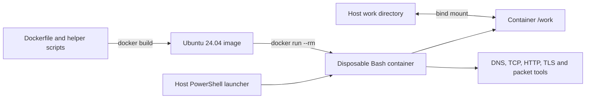

# IT Troubleshooting Toolbox

A disposable Ubuntu container for network diagnostics, HTTP/TLS inspection,
packet capture, and Python automation. Build once, launch a fresh shell when
needed, and keep reports in a bind-mounted `work/` directory.

The toolbox combines common troubleshooting utilities, a portable launcher,
and reusable diagnostic scripts in one environment. PowerShell runs on the
**host**; the container uses **Bash** and does not include PowerShell.

## Quick start

Requirements: Docker with a running **Linux** container engine, internet access
for the initial build, and PowerShell for the optional launcher. Run these
commands in **host PowerShell**, from this repository's root:

```powershell
docker version
docker info --format '{{.OSType}}'  # Expected: linux
docker build --pull --build-arg TOOLBOX_VERSION=1.0.0 -t it-toolbox:1.0.0 -t it-toolbox:latest .
.\toolbox.ps1
```

Inside **container Bash**:

```bash
pwd                         # /work
python3 --version
ip -brief address
dns-check.sh example.com A
web-check.sh https://example.com
printf 'Toolbox persistence test\n' > /work/persistence.txt
exit
```

Back in **host PowerShell**:

```powershell
Get-Content .\work\persistence.txt
```

`--rm` removes the stopped container, while its image and bind-mounted files
remain. Installing packages interactively only changes that temporary container;
make lasting changes in the Dockerfile.

## Repository and architecture

```text
it-toolbox/
|-- Dockerfile                 Ubuntu and tool installation
|-- README.md                  Build, usage, and maintenance guide
|-- toolbox.ps1                Portable host launcher
|-- scripts/                   Helpers installed into /usr/local/bin
|   |-- dns-check.sh
|   |-- port-check.sh
|   `-- web-check.sh
|-- tests/                     Offline container and launcher checks
|   |-- fixtures.py
|   |-- launcher.ps1
|   `-- smoke.sh
|-- examples/sample-output.md   Synthetic local-lab walkthrough
|-- work/.gitkeep               Persistent workspace; contents ignored
|-- .github/workflows/validate.yml
|-- .dockerignore
|-- .gitignore
|-- .gitattributes
|-- .editorconfig
|-- LICENSE                    MIT license
|-- CHANGELOG.md
`-- CONTRIBUTING.md
```



Helpers are copied into the image, so a plain `docker run` can use them without
mounting the repository. Editing a helper requires rebuilding the image. The
build context allowlist includes the Dockerfile, project license, and shipped helpers;
reports, examples, tests, and local inputs do not enter the image.

## Launch options

The launcher resolves its default `work/` beside `toolbox.ps1`, even when called
from another directory. It creates that folder if needed, handles spaces in
paths, and propagates Docker's exit code. It uses an interactive terminal only
when no command is supplied. Commas and double quotes in work paths are rejected
to avoid ambiguous Docker mount syntax. A custom relative work path is resolved
against the caller's current directory.

**Host PowerShell:**

```powershell
.\toolbox.ps1 -Image it-toolbox:1.0.0
.\toolbox.ps1 -WorkDirectory .\work\session-01
.\toolbox.ps1 -Command @('dns-check.sh', 'example.com', 'AAAA')
.\toolbox.ps1 -Command @('web-check.sh', 'https://example.com')
.\toolbox.ps1 -Command @('python3', '--version')
```

`-NoTty` suppresses terminal allocation for a no-command launch; for automation,
prefer an explicit `-Command` array. If local PowerShell policy prevents script
execution, use the direct Docker commands below or a supported script-signing
process.

A plain session has no persistent host folder:

```powershell
docker run --rm -it it-toolbox:1.0.0
```

For a named, mounted session that another terminal can join:

```powershell
New-Item -ItemType Directory -Force -Path .\work | Out-Null
$toolboxWork = (Resolve-Path .\work).Path
docker run --rm -it --name it-toolbox-session --mount "type=bind,source=$toolboxWork,target=/work" it-toolbox:1.0.0
```

In a second **host PowerShell** terminal:

```powershell
docker exec -it it-toolbox-session bash
```

**Linux/macOS host Bash**, from the repository root:

```bash
mkdir -p work
docker run --rm -it --name it-toolbox-session \
  --mount "type=bind,source=$(pwd)/work,target=/work" it-toolbox:1.0.0
```

A bind mount is writable: changes under `/work` affect the host immediately.
Other container paths disappear on removal. `work/` contents are ignored by Git
except `.gitkeep`; ignore rules do not remove files already tracked. Additional
scripts can be mounted read-only at `/scripts` and run with commands such as
`python3 /scripts/check.py`.
See Docker's [bind mount guide](https://docs.docker.com/engine/storage/bind-mounts/).

## Included utilities

The following commands run in **container Bash**. Set a target you own or are
authorized to test. The documentation address below is a placeholder, not a live
server. Ordinary public DNS and HTTPS examples use `example.com`.

```bash
TARGET_IP=192.0.2.10  # Replace with an authorized target
```

| Utility | Purpose | Example |
| --- | --- | --- |
| `bash` | Interactive shell and scripting | `bash /scripts/check.sh` (with script mount) |
| `dig` | DNS records and resolver status | `dig +time=3 +tries=1 example.com A` |
| `nslookup` | Quick DNS lookup | `nslookup -type=MX example.com` |
| `ping` | ICMP reachability | `ping -c 4 -W 2 "$TARGET_IP"` |
| `traceroute` | Responding network hops | `traceroute -n -m 15 -w 1 -q 1 "$TARGET_IP"` |
| `nc` (OpenBSD netcat) | TCP connectivity | `nc -vz -w 3 "$TARGET_IP" 443` |
| `nmap` | Selected ports and service detection | `nmap -sT -Pn -n -sV --version-light -p 443 --host-timeout 30s "$TARGET_IP"` |
| `curl` | HTTP requests, headers, and timing | `curl --connect-timeout 5 --max-time 15 -I https://example.com` |
| `openssl` | TLS and certificate inspection | See TLS example below |
| `tcpdump` | Capture container traffic | See capture example below |
| `ip` | Interfaces, routes, neighbors | `ip -brief address; ip route; ip neigh` |
| `ss` | Listening sockets and connections | `ss -lnt` |
| `jq` | Parse JSON | `ip -j address \| jq -r '.[].ifname'` |
| `whois` | Registration information | `timeout 15 whois example.com` |
| `python3` | Automation and local HTTP server | `python3 --version` |
| `pip3` / `venv` | Python package management | See virtual-environment example below |
| `tree` | Directory layout | `tree -a -L 2 /work` |

`ca-certificates` provides trusted roots for HTTPS. `timeout` and other basic
shell utilities come from the Ubuntu base. `dig` and `nslookup` are supplied by
`dnsutils`; `ip` and `ss` by `iproute2`.

### Helper scripts

```bash
dns-check.sh example.com              # A records and DNS status
dns-check.sh example.com MX
dns-check.sh example.com A 192.0.2.53  # Replace with a lab resolver
port-check.sh "$TARGET_IP" 443
web-check.sh https://example.com
web-check.sh https://example.com > /work/web-check.txt
```

All helpers reject missing or invalid arguments with exit code `2` and otherwise
return the underlying tool's exit code. DNS has a three-second query timeout and
one attempt; inspect the printed DNS status because `dig` can exit successfully
for `NXDOMAIN` or an empty answer. DNS types are case-insensitive and limited to
common types or the generic `TYPEnnn` form, because `dig` silently queries `A`
for an unknown type. A `PTR` check of an IP address performs a reverse lookup,
for example `dns-check.sh 192.0.2.10 PTR`. TCP checks accept one port in `1..65535` and
use a three-second connection wait; hostname resolution can add time. Web checks
perform a GET, discard the body, print headers and timing, enforce HTTPS
certificate verification (ignoring any `~/.curlrc`), and fail on HTTP 4xx/5xx. They accept only HTTP(S),
do not follow redirects, and have a 15-second total timeout. A redirect response
is therefore reported without checking its destination.

### Example troubleshooting workflow

Work from DNS to the application, using a lab hostname and address:

1. Resolve the name with `dig` and inspect DNS status and answers.
2. Compare name and IP reachability with `ping`.
3. Test the intended port with `port-check.sh`.
4. Identify the service with a narrow Nmap scan.
5. Inspect HTTP with `web-check.sh` and validate TLS with OpenSSL.
6. Save relevant results under `/work` and note the container's network context.

A failed ping does not prove a host is down. TCP success does not prove TLS or
application health. Nmap's `filtered` result is inconclusive; `open` is not a
vulnerability finding. Missing traceroute hops can simply mean no probe reply.

### TLS inspection

```bash
timeout 20 openssl s_client -connect example.com:443 -servername example.com \
  -verify_hostname example.com -verify_return_error -CApath /etc/ssl/certs </dev/null
```

Check the verification result, hostname, chain, and validity dates. Supplying SNI
selects the intended virtual host; hostname validation is a separate option.
Keep certificate verification enabled.

### Packet capture

In a named session with `/work` mounted, run the local HTTP lab in
[examples/sample-output.md](examples/sample-output.md), then use another shell
in that same container:

```bash
tcpdump -D
timeout --signal=INT 15 tcpdump -i any -p -nn -U -w - 'tcp port 8000' > /work/local-http.pcap
```

Generate a request in another host terminal during the capture:

```powershell
docker exec it-toolbox-session curl --max-time 5 http://127.0.0.1:8000/
```

Read the result in container Bash:

```bash
tcpdump -nn -r /work/local-http.pcap
```

The timeout normally exits `124` after ending the capture. Shell redirection
opens the output file before tcpdump can drop privileges. `-p` disables
promiscuous mode. The capture sees traffic in this container's network namespace,
not the Windows physical adapter or all other containers.

### Python, JSON, and persistent output

```bash
printf '{"services":[{"name":"web","healthy":true}]}\n' > /work/health.json
jq -r '.services[] | select(.healthy) | .name' /work/health.json
python3 -m venv /tmp/toolbox-venv
. /tmp/toolbox-venv/bin/activate
python -m pip --version
# Install pinned dependencies here if needed.
deactivate
```

The virtual environment is temporary. Keep reusable dependencies in a derived
image, or recreate the environment from a requirements file. Do not share a
Windows virtual environment with Linux. Python's HTTP server is a practice
utility; serve a dedicated demo directory rather than the reports folder.

To publish a temporary demo server to host loopback, run in **host PowerShell**:

```powershell
docker run --rm -it -p 127.0.0.1:8000:8000 it-toolbox:1.0.0 bash -c 'mkdir -p /tmp/demo; echo Toolbox-demo > /tmp/demo/index.html; exec python3 -m http.server 8000 --bind 0.0.0.0 --directory /tmp/demo'
```

Visit `http://127.0.0.1:8000` on the host. Stop the server with Ctrl+C.

## Networking and security

- Use networking tools only on systems you own or have permission to test.
  Keep scans and captures limited to the intended targets, ports, and duration.
- Under normal bridge networking, `localhost` means the container. Docker Desktop
  provides `host.docker.internal` for reaching host services; no published port
  is required for outgoing checks. On Linux Engine, add
  `--add-host=host.docker.internal:host-gateway` when needed and ensure the host
  service listens on a reachable interface.
- Docker Desktop runs Linux containers through a VM. Routing, VPN behavior, and
  DNS may differ from native host tools. See the official
  [networking guide](https://docs.docker.com/desktop/features/networking/).
- The default shell remains root to preserve diagnostic functionality. Raw-packet
  tools depend on runtime permissions such as `NET_RAW`; avoid `--privileged`.
  For ordinary DNS or HTTP queries, a reduced-permission example is
  `docker run --rm --user 65534:65534 --cap-drop=ALL --security-opt=no-new-privileges it-toolbox:1.0.0 dig example.com`.
- Mount only the folders needed. On Linux, use `--user "$(id -u):$(id -g)"` for
  ordinary report writing when host file ownership matters; some raw-packet
  operations will then be unavailable.
- Captures and verbose output can contain sensitive data. Review reports before
  sharing and keep credentials out of images, source control, and command lines.

## Testing

The repository includes offline smoke checks and a GitHub Actions workflow for
checking image builds, diagnostic helpers, and persistent storage.

After building, run the offline smoke checks from **host PowerShell**:

```powershell
$toolboxTests = (Resolve-Path .\tests).Path
docker run --rm --network none --mount "type=bind,source=$toolboxTests,target=/tests,readonly" it-toolbox:1.0.0 bash /tests/smoke.sh
.\tests\launcher.ps1 -Image it-toolbox:1.0.0
```

The smoke check starts loopback HTTP, HTTPS, and DNS fixtures, then verifies
installed commands, trusted CA data, helper syntax, the exact exit code for each
invalid argument, DNS answers, `NXDOMAIN` and reverse lookups, TCP and Nmap
connectivity, HTTP success, failure, and unfollowed redirects, HTTPS certificate
enforcement, helper timeouts, JSON parsing, and Python virtual environments. It
takes about 20 seconds because it waits for the timeouts. It does not contact
external hosts or verify ICMP, WHOIS, or packet-capture behavior. Use the
feature examples for those environment-dependent checks.

The launcher check covers the default and relative work paths, spaces, comma
rejection, exit-code propagation, and passing quotes and empty arguments through
to the container. GitHub Actions builds the image, lints Bash with ShellCheck,
parses PowerShell, runs the smoke check, and runs the launcher check twice on
Ubuntu, once with the argument passing that Windows PowerShell 5.1 uses. Repeat
launcher verification on Windows when changing host path handling.

## Troubleshooting

| Symptom | Next check |
| --- | --- |
| Docker CLI works but server is unavailable | Start Docker Desktop, confirm engine access, and select Linux containers. |
| Build download or certificate failure | Check internet connectivity, proxy settings, and trusted CA configuration. |
| Bind mount fails | Confirm the source exists and Docker can access it; use a local Docker context. |
| DNS differs from host results | Compare `/etc/resolv.conf`, VPN routing, and Docker DNS settings. |
| Raw-packet operation is not permitted | Check runtime capabilities; use TCP connect checks when appropriate. |
| Empty capture | Generate traffic in the same container and verify the filter. |
| Report disappears after exit | Save it under the mounted `/work`. |
| Named container already exists | Join the intended session or choose another name. |
| Python package installation is blocked | Create a virtual environment instead of modifying system Python. |

## Versioning and maintenance

The project version is `1.0.0`. Keep the Dockerfile default, release tag, build
argument, and changelog aligned. Use patch versions for fixes, minor versions for
compatible additions, and major versions for breaking interface changes.

Rebuild regularly and after relevant upstream fixes. For a future patch release,
update the version and changelog, then run in **host PowerShell**:

```powershell
docker build --pull --no-cache --build-arg TOOLBOX_VERSION=1.0.1 -t it-toolbox:1.0.1 .
# Repeat the validation commands with it-toolbox:1.0.1 before moving latest.
docker tag it-toolbox:1.0.1 it-toolbox:latest
New-Item -ItemType Directory -Force -Path .\work | Out-Null
docker image inspect it-toolbox:1.0.1 --format '{{.Id}}' | Set-Content .\work\image-id-1.0.1.txt
.\toolbox.ps1 -Image it-toolbox:1.0.1 -Command @('bash', '-c', 'dpkg-query -W > /work/packages-1.0.1.txt')
```

`latest` is a movable tag, not automatic updating. Keep the previous image tag
for rollback. The Ubuntu tag and package repositories change, so rebuilding the
same version need not produce identical bytes. Record image IDs and package
inventories; pin a verified base digest and package sources if exact rebuilds
are required. Review image vulnerabilities with an image vulnerability scanner. See
Docker's [build guidance](https://docs.docker.com/build/building/best-practices/).

## License

This project's original code and documentation are licensed under the
[MIT License](LICENSE).

The image includes this license at `/usr/share/doc/it-toolbox/LICENSE` and declares
`MIT` in its OCI license metadata. Installed third-party tools retain their own
licenses under `/usr/share/doc`; this project's MIT license does not replace them.
